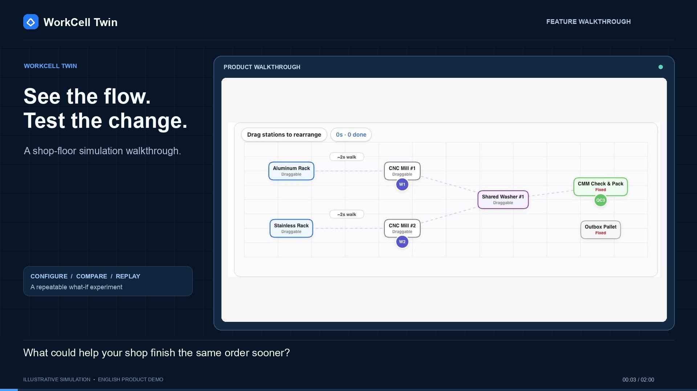

# WorkCell Twin

**Explore shop-floor bottlenecks before changing your layout or buying equipment.**

WorkCell Twin is an interactive manufacturing simulation prototype. Configure a small workcell, adjust the order mix and operation times, and compare four improvement options through metrics and animated replay. The interface opens on the setup screen in English, with a Korean language option.

## Demo

[](artifacts/workcell-demo/workcell-twin-demo-en.mp4)

[Watch the two-minute walkthrough](artifacts/workcell-demo/workcell-twin-demo-en.mp4) · [English subtitles](artifacts/workcell-demo/workcell-demo.en.srt)

The video uses actual application screens and simulation playback, with English captions and background music.

## Quick start

With Node.js and npm installed, run:

```bash
npm ci
npm run dev
```

Open [http://localhost:3000](http://localhost:3000). No API key is required for the interactive simulation.

To run a production build:

```bash
npm run build
npm start
```

Development output is stored in `.next-dev`; production output uses `.next`, so a production build does not overwrite a running development server's assets.

## Using the simulator

1. **Choose an industry.** Start with CNC & Metal Shop, Food & Packaging, Medical Device, or Electronics & PCB. These presets use a shared process model with different labels, layouts, timings, and costs.
2. **Set up the workcell.** Drag movable stations on the floor plan. The model includes two production workers, a dedicated inspection worker, material bins, shared equipment, and a shipping area.
3. **Enter the work.** Adjust quantities for products A and B and the times for material handling, production, shared-equipment work, and inspection/packing. Configure changeover and rework settings. Standard and urgent order buttons change the order quantities.
4. **Compare four options.** Review completion time, worker activity, waiting, movement, and illustrative cost/payback estimates under the same inputs.
5. **Replay the results.** Play, pause, restart, or seek through the timeline. Switch between a 2D floor plan and an isometric view, display all four scenarios together, or jump to a highlighted bottleneck interval.

| Scenario | Change being evaluated |
| --- | --- |
| Current layout (`baseline`) | Keep the original workcell. |
| Move bins (`move_bins`) | Relocate material bins closer to production. |
| Add equipment (`add_tool`) | Add another shared tool or machine. |
| Add transport robot (`add_robot`) | Add a robot to supply material to workers. |

## How the simulation works

The TypeScript engine advances the workcell in **0.5-second steps**. A central loop updates worker and robot state, movement, operation progress, equipment occupancy, queues, changeovers, and scripted rework. Input changes recalculate four scenarios under each of two scheduling policies, producing eight result sets. The canvas then replays the recorded snapshots.

| Policy | Current implementation |
| --- | --- |
| `fixed_fifo` | Process orders in a fixed sequence and wait when shared equipment is occupied. |
| `ai_adaptive` | Use coded heuristics for order selection, inspection load, grouping the same product, and picking upcoming material while waiting. |

The UI's **AI scheduling** option currently uses rule-based heuristics. Workers are simulated entities with state machines; they do not make individual language-model calls. There is no Managed Agents integration, companion-model execution, or automated model verification loop in the current implementation. Replay and insight cards help inspect simulated behavior; they do not establish physical validation.

Application state is held in the browser and resets on reload. There is no database or saved-project service.

## Optional Gemini endpoint

The server route [`src/app/api/argon/route.ts`](src/app/api/argon/route.ts) implements `POST /api/argon` with two actions:

- `parse_instructions`: returns preset process data selected by keyword rules, with an optional model-generated summary and assumption note.
- `explain_comparison`: returns a template report, with an optional model-generated explanation and recommendation.

To configure the server-side key, copy the example file and set your own value:

```bash
cp .env.example .env.local
```

The route currently specifies `gemini-4-argon`. Live use requires a model identifier supported by your account; the identifier is set in the route. If a model request fails or no key is available, the route returns its deterministic fallback. Its prompts currently request Korean output.

**The visible setup and comparison workflow does not invoke this endpoint.** Setting a key alone does not enable model-driven scheduling or instruction extraction in the UI. The optional model calls generate explanatory text and do not control the simulation.

Keep real keys in `.env.local` or your deployment environment. Only the empty `.env.example` belongs in source control.

## Prototype scope

This project demonstrates workcell comparisons and bottleneck shifts. Its results have not been calibrated against a real factory.

- The industry presets share a simplified four-stage process. The engine does not model collision avoidance, aisle geometry, machine downtime, or independent machine/operator capacity in detail.
- Rework settings trigger predefined rework cases rather than sampling a statistical defect rate. Some declared constraint fields are not enforced by the engine.
- Runs have a 720-second safety cap. Larger workloads can reach that cap before every order finishes, and the current UI does not clearly flag incomplete runs.
- Cost, payback, and recommendation text use preset assumptions and simplified formulas. They are illustrative outputs.
- The **Field Validation** tab supplies placeholder measurement values until edited, and its match badge is not computed from a validation test. Entering measurements does not calibrate the engine or start a verification loop.

## Project structure

```text
src/
  app/
    page.tsx                 Setup, comparison, replay, and validation UI
    layout.tsx               Page metadata and default document language
    globals.css              Global styles
    api/argon/route.ts       Optional Gemini explanation endpoint
  components/
    WorkshopCanvas.tsx       Floor-plan editor and 2D/isometric renderer
  lib/
    presets.ts               Industry presets and example process data
    simulationEngine.ts      Simulation, scheduling, metrics, and insights
  locales/
    en.ts, ko.ts, index.ts    English and Korean interface text
  types/
    simulation.ts            Shared data types
artifacts/workcell-demo/      Finished walkthrough, poster, and subtitles
```

Built with Next.js 15, React 19, TypeScript, Tailwind CSS 4, Canvas 2D, Lucide icons, and the Google Gen AI SDK for the optional server endpoint.

## Development checks

```bash
npm run build
npx tsc --noEmit
```

An automated test suite is not configured. The existing `npm run lint` script requires ESLint setup before it can be used as a noninteractive check.

## Sharing this project

The upload package contains the application source, dependency lockfile, configuration, this README, and the finished demo assets. Dependencies, build output, local environment files, editor/agent state, and raw video capture files are excluded.

Extract the ZIP before uploading the project files to a GitHub repository. Keep `.gitignore` and the empty `.env.example` with the project; `.gitignore` does not remove secrets that have already been committed.
